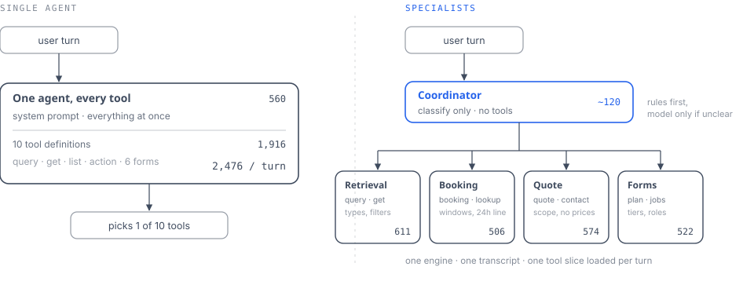

# @nxisai/agent-harness

An on-device agent for the browser. It runs a small model locally over WebGPU, discovers the tools your page exposes (WebMCP and remote MCP), and decides per turn whether to run a tool, ask for what is missing, or confirm before writing.

No server. No API key. The model runs in the tab.

```bash
npm install @nxisai/agent-harness
```

## Quick start

```js
import '@nxisai/agent-harness/ui';
```

```html
<nxis-agent></nxis-agent>
```

The element registers itself, finds the page's tools, and renders a chat surface with an inline launcher. That is the whole integration for a single agent. It opens as a window in the corner; `mode` makes it full screen or inline instead (see [Window or full screen](#window-or-full-screen)).

`<nxis-agent-fullscreen>`, the element's old name, still works as a deprecated alias and will be removed in a later minor: it is the same element, opens full screen unless `mode` or the viewer's stored choice says otherwise, and logs one deprecation warning per page. Rename it to `<nxis-agent mode="fullscreen">` to keep that, or to `<nxis-agent>` for a window. The classes are exported from `@nxisai/agent-harness/ui` as `NxisAgent` and, deprecated, `NxisAgentFullscreen`.

### Without a bundler

`npm run build:cdn` builds the element as a self-contained browser bundle, for a page that loads it from a URL with no npm install and no bundler:

```html
<script type="module" src="https://<cdn>/harness/0.15.3/ui.js"
        integrity="sha384-…" crossorigin="anonymous"></script>
<nxis-agent></nxis-agent>
```

| Path | What | Cached |
|---|---|---|
| `harness/<version>/ui.js` | `@nxisai/agent-harness/ui`, bundled: importing it registers `<nxis-agent>` | a year, `immutable` |
| `harness/<version>/<name>-<hash>.js` | each part the element loads on first use (media, guardrails, sources, feedback), beside `ui.js` | a year, `immutable` |
| `harness/<version>/proxy.js` | `createProxyProvider`, self-contained: `el.modelProvider = createProxyProvider({ endpoint })` | a year, `immutable` |
| `harness/<version>/manifest.json` | every file's size and Subresource Integrity hash, and which chunk is which | a year, `immutable` |
| `harness/<major>.<minor>/ui.js`, `proxy.js`, `manifest.json` | the latest patch of that minor: `ui.js` and `proxy.js` re-export the versioned files | five minutes |

Use the versioned URL with its `integrity` hash from `manifest.json`. The minor alias suits a loader that reads `manifest.json` first and then imports the versioned file. A dynamic `import()` takes no `integrity` attribute; to check the lazy chunks too, give the page an import map with an `integrity` entry for each file in the manifest.

The bundle is the same code, byte for byte, that the size budget measures (`npm run size:cdn` checks it file by file), and a page may load it more than once: the alias and the versioned URL are one module, and a second copy of the harness (another version, or the npm build in the site's own bundle) leaves the first one's element in place instead of throwing. It is served from S3 behind CloudFront: `dist-cdn/upload.json` gives each object its key, `Content-Type` and `Cache-Control` (set as S3 object metadata at upload), and the CDN's response headers policy adds `Access-Control-Allow-Origin: *`, `X-Content-Type-Options: nosniff` and `Cross-Origin-Resource-Policy: cross-origin`. `npm run smoke:cdn` loads the build in a plain page in Chromium and runs one turn against a stub proxy.

## Single agent or multiple agents

The element supports two modes. The default is one agent that reads every tool on the page. The optional mode adds a coordinator and a set of specialists; each turn then loads one agent's instructions and one agent's tools instead of everyone's.




Numbers above are from one site (six forms, four retrieval tools). Tool definitions are re-sent on every turn and are most of what a small model reads; the saving comes from what each agent does not load, and the accuracy comes from choosing between two tools instead of ten.

### Single agent

Nothing to configure beyond the prompt:

```js
const agent = document.querySelector('nxis-agent');
agent.systemPrompt = '…';
agent.suggestions = ['Find a plumber', 'Book a visit'];
```

### Multiple agents

Declare the specialists, a rule table, and a fallback. The element builds an `AgentHarness` per entry over its one engine and places an `AgentCoordinator` in front. Clear `agents` to return to single-agent mode.

```js
agent.agents = {
  retrieval: {
    systemPrompt: RETRIEVAL_PROMPT,
    tools: (t) => /^nxis_(query|get)$/.test(t.name),
    description: 'questions about services, ratings and areas',
    unavailable: 'I cannot search the site records from here right now.',
  },
  booking: {
    systemPrompt: BOOKING_PROMPT,
    tools: (t) => /book|appointment/i.test(t.name),
    description: 'booking a visit',
    unavailable: 'I cannot book a visit from here. The booking page can.',
  },
};
agent.routes = [
  { route: 'booking',   match: /\b(book|schedule|appointment)\b/ },
  { route: 'retrieval', match: /\b(hours|rated|cover|who|find)\b/ },
];
agent.fallback = 'retrieval';
```

Each `AgentDefinition` field:

| Field | Purpose |
|---|---|
| `systemPrompt` | This agent's instructions. Asserted at the head of the shared transcript on every turn. |
| `tools(tool)` | Which registered tools this agent may use. Match by name. |
| `description` | One line for the model classifier. Read only when the classifier runs. |
| `unavailable` | What the agent says when none of its tools are on the page. |

### How a turn is routed

A turn checks a rule table first and routes with no model call. If the rules are unclear, a short classification pass runs. The chosen specialist keeps handling later turns without re-routing, and can hand back once if the model asks for a tool it does not hold.


Cheapest path first:

| Path | When | Cost |
|---|---|---|
| rules | a rule matches | none |
| sticky | rules abstain; the conversation is already with an agent | none |
| model | rules abstain; no history; an engine is supplied | one short generation (no tools, 12-token cap) |
| fallback | nothing decided | none |
| hand-back | the agent's model asks for a tool it does not hold | one extra turn, at most once |

Rules vote; `weight` breaks ties; a tie that nothing separates abstains rather than guessing. Stickiness is released when an agent reports `unavailable`, so a follow-up does not return to an agent that cannot act.

## Models

Gemma 4 on WebGPU is the default and needs no configuration. To run the agent on a model you host or proxy, point `createProxyProvider` at your own endpoint:

```ts
import { createProxyProvider } from '@nxisai/agent-harness';

agent.modelProvider = createProxyProvider({ endpoint: '/api/agent' });
```

Your endpoint holds the vendor key and answers `{ text, call?, usage? }`. The request and response shapes, and the four rules that are silent when broken, are in [docs/remote-providers.md](docs/remote-providers.md).

For a transport that is not an HTTP POST of that shape, implement `ModelProvider` directly:

```ts
interface ModelProvider {
  readonly name: string;
  readonly label?: string;     // shown beside the input: "Gemma 4 E2B", "Claude"
  readonly local: boolean;     // false makes the header badge read "Remote"
  readonly ready: boolean;
  readonly loading: boolean;
  load?(): Promise<void>;      // omit for a provider with nothing to download
  preload?(mode: 'eager' | 'idle'): void;
  complete(req: CompletionRequest): Promise<Completion>;
  countTokens?(text: string): Promise<number>;
}

interface Completion {
  text: string;                                          // rendered verbatim
  call?: { name: string; args: Record<string, unknown> };
  usage?: { promptTokens: number; outputTokens: number };
  model?: string;                                        // which model answered, shown beside the input
}
```

```js
agent.modelProvider = myProvider;     // or: new AgentHarness({ provider, renderer })
```

The boundary carries a structured completion rather than a string. Gemma announces tool calls in text, so `LocalGemmaProvider` parses its own markers; Claude, Gemini and Kimi return native tool-use blocks and map them onto `call`. The harness parses nothing either way.

**Put your model behind your own origin.** A vendor key in a browser is a key anyone can read from the page source, and a browser cannot rate-limit or audit itself. `createProxyProvider` is the client half; [docs/remote-providers.md](docs/remote-providers.md) has the contract and a worked Claude endpoint for the other half.

Three optional members are how the UI adapts. Omit `load` and the whole download treatment is skipped (no charging ring, no byte counts). Omit `countTokens` and the token metrics panel is hidden rather than rendered as zeroes. `local: false` puts `Remote` in the header, because the package's claim is that nothing leaves the tab and the exception has to be visible.

### Self-hosting the weights

The Hub rate-limits, and a busy site meets it as `Error (429) … tokenizer.json` on a visitor's first load. Point the element at your own origin instead:

```html
<nxis-agent model-host="https://d111111abcdef8.cloudfront.net"></nxis-agent>
```

```ts
new LocalGemmaProvider({ modelHost: 'https://d111111abcdef8.cloudfront.net' });
```

**The URL it asks for** is `model-host` + `model-path-template` with `{model}` replaced by `onnx-community/gemma-4-E2B-it-ONNX`. The template defaults to `{model}/`, so files are expected at:

```
https://your-host/onnx-community/gemma-4-E2B-it-ONNX/tokenizer.json
https://your-host/onnx-community/gemma-4-E2B-it-ONNX/onnx/decoder_model_merged_q4f16.onnx_data
```

To keep a tidier key prefix, flatten it: upload under `gemma/` and set `model-path-template="gemma/"`. The template is a literal with `{model}` substituted, so one without the placeholder is a constant path.

**What to mirror** — the configs and the `q4f16` weights, about 3.4 GB. The vision and audio encoders are included because the model class loads all four sessions even though this package uses the tokenizer alone for text:

```bash
huggingface-cli download onnx-community/gemma-4-E2B-it-ONNX \
  --include "*.json" "chat_template.jinja" "onnx/*q4f16*" \
  --local-dir ./gemma-4-E2B-it-ONNX

aws s3 sync ./gemma-4-E2B-it-ONNX \
  s3://YOUR_BUCKET/onnx-community/gemma-4-E2B-it-ONNX/ \
  --cache-control "public, max-age=31536000, immutable"
```

**CORS is required** — the weights are fetched cross-origin from your page:

```json
[{
  "AllowedOrigins": ["https://your-site.example"],
  "AllowedMethods": ["GET", "HEAD"],
  "AllowedHeaders": ["*"],
  "ExposeHeaders": ["Content-Length", "Content-Range", "Accept-Ranges"],
  "MaxAgeSeconds": 86400
}]
```

Two things worth knowing. Put CloudFront (or any CDN) in front: this is 3.4 GB per cold visitor, and S3 egress priced per visitor is the kind of bill that arrives once. And the download is a first-load cost only — the browser keeps the files in Cache Storage afterwards, which is what `cache="false"` turns off.

### The cache hint

`CompletionRequest.cache` carries `{ stableMessages, toolsStable }`: what the harness knows will repeat next turn. The harness cannot cache anything itself, and never depends on a hit. Acting on it is your endpoint's decision, and only where the vendor supports it.

Both flags go false at a specialist handoff, which swaps the system prompt and the tool slice. Sticky routing therefore keeps a prefix stable within a topic and invalidates it at the boundary.

## Element API

### Properties

| Property | Type | Default | Notes |
|---|---|---|---|
| `systemPrompt` | `string` | packaged prompt | See [Prompts](#prompts). |
| `suggestions` | `string[]` | two generic chips | Empty-state chips. `[]` shows none. |
| `emptyState` | `string` | describes the mechanism | Line above the chips. |
| `name` | `string` | `"Nxis Agent"` | Header, launcher tooltip, dialog accessible name. |
| `logo` | `string` | Nxis mark | Inline SVG markup, or an image URL. |
| `theme` | `AgentTheme` | NxisAI palette | See [Theming](#theming). |
| `agents` | `Record<string, AgentDefinition> \| null` | `null` | Enables multi-agent mode. |
| `routes` | `RouteRule[]` | `[]` | Ignored unless `agents` is set. |
| `fallback` | `string` | first agent declared | Ignored unless `agents` is set. |
| `modelProvider` | `ModelProvider \| null` | `null` | A remote model. Null means local Gemma. See [Models](#models). |
| `preload` | `'eager' \| 'idle' \| 'none'` | `'idle'` | When weights are fetched. Local provider only. Settable mid-session. Always `'none'` when `contained`. |
| `contained` | `boolean` | `false` | Same as the attribute. See [Previewing the chat](#previewing-the-chat). |
| `allowInput` | `boolean` | `false` | Same as the `allow-input` attribute. |
| `isOpen` | `boolean` (read-only) | `false` | Whether the window is showing. Changes fire `nxis-agent-toggle`. |
| `debug` | `boolean` | `false` | Shows tool receipts and route labels, and draws each guardrail decision in the thread. |
| `preferences` | `AgentPreferences` | session-scoped | See [Preferences](#preferences). |
| `handoff` | `HandoffConfig \| null` | `null` | Hand conversations to other agents and people. See [Handoff](#handoff-to-an-agent-or-a-person). |
| `guardrails` | `GuardrailsConfig` | standard defaults | Read live; always has `lockdown()`. Setting it merges shallowly over what is there; `null` resets to the defaults. See [Guardrails](#guardrails). |

### Attributes

| Attribute | Values | Purpose |
|---|---|---|
| `preload` | `eager`, `idle`, `none` (`false` also means `none`) | Same as the property. |
| `debug` | present, or `"false"` | Same as the property. Raw tool payloads appear only with it on, as a collapsed trace under the reply. |
| `mode` | `window` (default), `fullscreen`, `inline` | Dock in the corner at `--window-w` × `--window-h` (400 × 620); cover the page; or fill the box the host puts it in and stay open — for a copilot rail the host lays out. Below 520px a window covers the page anyway. See [Window or full screen](#window-or-full-screen). For the window drawn inside a box on your own page, as a preview, use `contained` instead. |
| `contained` | present | Draw the window and its launcher inside the host's box rather than fixed to the viewport, and fetch nothing: a preview of what a visitor sees. Implies `discover="false"`, `site-actions="false"` and `preload="none"`, and overrides `mode`. See [Previewing the chat](#previewing-the-chat). |
| `allow-input` | present | With `contained`, take messages: the input, send button and suggestion chips work as in the other modes. Off by default. No effect without `contained`. |
| `no-mode-toggle` | present | Hide the header's window / full-screen toggle. |
| `discover` | `"false"` | Skip remote MCP discovery. |
| `site-actions` | `"false"` | Don't fetch the actions on other pages of the site. |
| `prompt-style` | `"classic"` | Use the separate ask, "Ready to send" and "Submitted" cards, and the per-record result cards, of earlier versions instead of the action card and the recommended pick. |
| `cache` | `"false"` | Do not store model files in Cache Storage. |
| `model-host` | URL | Fetch weights from another origin. |
| `model-path-template` | string | Path template under `model-host`. |
| `a2ui` | `"false"` | Use the legacy DOM renderers. |
| `auto-open` | present | Open on connect. With `contained`, without taking focus. |
| `media` | `play`, `open` (default) | `play`: free episodes and videos play in a docked player inside the chat instead of opening their page. See [Media in the chat](#media-in-the-chat). |
| `media-play` | `unmarked` | With `media="play"`, records that say nothing about access play too. |
| `link-origins` | origins, space-separated | Other origins a handoff target's reply may link to, and the agent may open (`open_page`, a card's link) without asking, besides this page's own. See [Links in a reply](docs/handoff.md#links-in-a-reply) and [Guardrails](#guardrails). |
| `guardrails` | `strict` | Selects the strict preset. See [Guardrails](#guardrails). |
| `guardrails-src` | URL | Where the model proxy serves its guardrails policy (usually the proxy's own endpoint, `/api/agent`). Fetched by the guardrails' lazy code, cached with its ETag, and merged over `guardrails` tighten-only. If it can't be fetched, the built-in defaults apply. See [docs/guardrails-policy.md](docs/guardrails-policy.md). |

### Methods

```js
agent.open();   // show the window, as the launcher does
agent.close();  // back to the launcher, as ✕ does; nothing when already closed
agent.isOpen;   // true while the window is showing
agent.addEventListener('nxis-agent-toggle', (e) => e.detail.open); // on every change, whatever caused it
```

`close()` works in every mode (in `inline`, which has no launcher, `open()` brings it back). Focus inside the agent moves to the launcher, as with ✕; focus elsewhere on the page stays where it is. `nxis-agent-toggle` is a `CustomEvent` that bubbles and crosses shadow roots, fired once for each change from the launcher, ✕, `open()`, `close()` or `auto-open`, and never when the state didn't change. Escape doesn't close the window: it stops a turn or closes the conversation drawer.

### Window or full screen

The agent opens as a window docked in the corner unless the host sets `mode`. While it is open, a button in its header (**Expand to full screen** / **Shrink to a window**) switches between the two. Only the panel's shape changes: the conversation, its scroll position, focus and any open handoff stay as they are. The button is hidden in `inline` mode, below 520px (where a window already covers the page) and with `no-mode-toggle`. With `contained` it fills the host's box instead: see [Previewing the chat](#previewing-the-chat).

The viewer's choice is kept in `localStorage` under `nxis-agent:mode`. Which mode the element uses, first match wins:

1. what the viewer toggled to on this page (setting the `mode` property afterwards replaces it);
2. the host's `mode` attribute (or the `mode` property);
3. the viewer's stored choice;
4. `window`.

So a host that sets `mode` explicitly always gets that mode on load, and the stored choice only applies where the host left it unset. Without storage (a private window, blocked site data) the toggle still works, and isn't remembered.

```js
agent.addEventListener('nxis-mode-change', (e) => e.detail.mode); // 'window' | 'fullscreen', when the viewer toggles
```

### Previewing the chat

`contained` draws the chat exactly as a visitor gets it in window mode, but inside a box on your own page: for a settings screen that previews a site's branding, say. It is the same launcher and the same window, with the same markup, CSS, sizes, shadow, header buttons and footer. Only the position differs: the launcher and the window sit 20px from the box's bottom-right corner rather than the viewport's, at `--window-w` × `--window-h`, capped to the box less 16px a side.

- **Opening and closing work as on a page.** The launcher opens the window, ✕ closes it back to the launcher (and focus returns to the launcher), and `auto-open` starts it open, without taking focus from your page or scrolling to it.
- **Expand fills the box.** The header's **Expand to full screen** button is there, as a visitor sees it, and fills the host's box (conversations in a drawer, as in a window); **Shrink to a window** puts it back. The choice isn't stored. The `mode` attribute, the viewer's stored mode and the 520px narrow-viewport rule don't apply: the box is the screen.
- **Messages are off.** A preview is for seeing the look, so the input and the send button are disabled (the send button faded, as it is while disabled elsewhere), the placeholder reads "Preview only: messages are off", and the suggestion chips are drawn as a visitor sees them but send nothing. The header, the launcher, and opening and closing all work. `allow-input` turns messages on, for a preview with a provider that answers.
- **Nothing outside the box.** The element sets `position: relative`, `z-index: 0` and `overflow: hidden` on itself, so the window, its shadow and its z-index stay inside. There is no scroll locking or focus trapping, and Tab moves through the chat and on to your page as usual.
- **Nothing is fetched.** It implies `discover="false"`, `site-actions="false"` and `preload="none"`. Opening loads only a `modelProvider` you supply, never the on-device model. Conversations aren't read from or written to storage, and nothing left pending on another page is resumed.

Give the element a size, as for `inline` (it takes `height: 100%` of its parent), and a stub provider. Set the properties before it is connected, so the first paint is already branded:

```js
import '@nxisai/agent-harness/ui';

const agent = document.createElement('nxis-agent');
agent.setAttribute('contained', '');
agent.setAttribute('auto-open', '');
agent.name = 'Wrenfield';
agent.logo = 'https://example.com/logo.svg';
agent.theme = { accent: '#C2410C', accentStrong: '#9A3412', accentTint: '#FFF1E8' };
// What visitors' chat shows beside the input: here, a model proxy's.
agent.modelProvider = {
  name: 'preview', label: 'proxy', local: false, ready: true, loading: false,
  complete: async () => ({ text: 'This is a preview.' }),
};
document.querySelector('#preview-box').append(agent); // a box with a width and height
```

To keep a control of your own in step with the preview (a "Chat button / Open chat" switch, say), use `open()`, `close()`, `isOpen` and `nxis-agent-toggle` rather than reaching into the element:

```js
const toggle = document.querySelector('#show-open');
agent.addEventListener('nxis-agent-toggle', (e) => { toggle.checked = e.detail.open; });
toggle.addEventListener('change', () => (toggle.checked ? agent.open() : agent.close()));
toggle.checked = agent.isOpen;
```

The event also fires for the visitor's own presses on the launcher and ✕ inside the preview, so the switch follows them too.

### Preferences

Standing values used to fill forms. Session-scoped unless `persist` is set.

```js
agent.preferences.set({ name: 'Jane Doe', email: 'jane@example.com' });
agent.preferences.set('phone', '555-0100');
agent.preferences.get();           // all
agent.preferences.get('email');
agent.preferences.keys();          // ['name', 'email', 'phone', 'address']
agent.preferences.clear('phone');
agent.preferences.clear();
agent.preferences.persist = true;  // survive reloads; false deletes the stored copy
agent.addEventListener('nxis-preferences-change', (e) => e.detail.preferences);
```

Keys map onto differently named schema fields (`name` satisfies `full_name`, `fullname`, `name`). Extend `PROFILE_ALIASES` to add one.

### Theming

`theme` merges over the defaults. Each key writes two custom properties (the element's own CSS and its Tailwind utilities use different names), so set colors here rather than in CSS.

```js
agent.theme = {
  accent: '#B45309', accentStrong: '#92400E', accentTint: '#FDF3E7',
  ink: '#0E1C2B', inkSoft: '#40566D', inkMuted: '#8A97AC',
  bg: '#FFFFFF', surface: '#FBFAF8', border: '#E2DDD6',
  radius: '14px',
  fontDisplay: 'Manrope, sans-serif', fontSans: 'Inter, sans-serif', fontMono: 'JetBrains Mono, monospace',
};
```

Green and red are not themeable. Fonts are not bundled; load them or point the font keys at faces you ship. The footer's "Powered by NxisAI" badge is not affected by `logo` or `theme`.

### Prompts

Two lines of the packaged prompt do real work. Keep them if you rewrite it:

> Call the tool as soon as you know which one is right, even if some required fields are still unknown; include the fields you do have and omit the rest. Never ask the user to supply a missing field in prose.

The harness collects missing fields as fields (one question, a stepper, or a confirm card). A prompt that tells the model to ask in prose produces a paragraph of questions instead.

## What a turn does

Given the tool the model picked and everything already known, the harness asks what is still unknown:

| Tool | Gaps | Result |
|---|---|---|
| read (`readOnlyHint`) | none | runs; several records end with a recommended pick; then the model answers |
| read | some | asks only for those, then runs and answers |
| write | none | action card: what will be sent, and Send |
| write | some | action card: what it has, the fields still needed, then Send |

A read is a step, not the end of a turn. Once its results are drawn, the model reads them back and either calls the next read it needs (`nxis_list_types` to pick a type, then `nxis_query`) or answers in a sentence or two from what came back, under the cards. A turn has at most three reads (the guardrails' `tools.maxPerTurn`, if lower), after which the model is offered no tools and can only answer; the same read isn't run twice. A reply with neither words nor a call is asked for once more, with no tools, and then the cards stand with "Here's what I found." (or "I couldn't find that here." after nothing, or after only a type listing). Each of these is one more completion, inside the guardrails' step and token budgets.

Read and write are where the tier starts: the guardrails decide what runs unreviewed. An unannotated tool is treated as a write, and a remote read is logged. See [Guardrails](#guardrails).

### Search results: a pick, and why

When a search returns two or more records, the harness asks the model one more question: which of these fits what the visitor asked, and why. The model answers through a `recommend` call (the result's number, one sentence naming it, two or three reasons). Then every reason is checked against the record it picked:

- every number in it must be one the record states ("4.7", "412", "40 minutes");
- "open now" and "24/7" must match the record's opening hours, read at the time of the search;
- it must share a meaningful word with the record, and not be about another result.

Reasons that fail are dropped. If none survive, there is no pick. The widget shows the pick with its reasons ticked, a Call button, "Their page", and "Get a quote" when the site has a form for that business. Under it, "Also good · tap to compare" lists the others. Comparing one shows its own facts without ticks, because the agent did not recommend it. With no pick, the results are a short list that opens per result.

Each record's hours become "Open now · 24/7", "Open now · until 5pm" or "Opens 7am" (`openingHoursSpecification` or `openingHours`). `recommend: false` skips the extra completion; `prompt-style="classic"` keeps the earlier result cards. `extractRecords`, `recordFacts`, `openStatus`, `recommend` and `grounded` are exported for hosts that render results themselves.

### Media in the chat

Pictures always show: a record's tile is its first picture, and an `ImageObject` draws as a figure with its caption, credit and License, its space kept before it loads.

Playing is opt-in: `<nxis-agent media="play">`. Listen, "Listen to preview" and "Listen to the latest" then play in a **Now playing** bar between the conversation and the composer (a video gets a frame above it, up to 40% of the viewport), and a record that plays but has no Listen gets a Listen or Watch button. Without the attribute, the cards are exactly what they were, and Listen opens its page.

- **Only free media plays.** A free item, or a preview or trailer that is itself marked `isAccessibleForFree: true`. Paid, subscription and sign-up media never plays, even when its file is public; nor does anything past its `expires`. A record with no access markup plays only with `media-play="unmarked"`. The check runs again on every tap, for cards saved with the conversation too.
- **Nothing loads before a tap.** The player is its own module, `@nxisai/agent-harness/media`, loaded with a dynamic `import()` on the first tap (or when a Play button is pointed at or focused): a page that never plays anything downloads none of it. `play()` runs inside the tap, as iOS requires. "Listen to the latest" fetches its episode (`nxis_get`) once, as the series' card is drawn, since a series' parts carry no media.
- **One at a time.** Starting ours pauses any `<audio>` or `<video>` playing on the page; the page's own player starting pauses ours. Nothing advances on its own. Redraws of the conversation, and switching conversations, don't stop it. Closing the panel pauses a video; audio goes on, with a small pause button beside the launcher.
- **When it can't play here** (the page's Content-Security-Policy refuses the file, the file errors, or no frame arrives 15 s after Play), its host is blocked for the session, the bar says "Can't play here. Open the episode page", and its buttons open the page again. HLS plays only where the browser plays it natively; DASH and embeds open the page. No HLS library is bundled.
- **Counted** as the NxisAI app counts it: the first play of each item reports `page_open` with its ListenAction or WatchAction, once per page load. Each play, pause, end, error and block is also an `nxis-media` event on the element (`detail.type`, `id`, `kind`, `title`, `page`), for the site's own analytics.
- **Controls:** play/pause, a scrubber, the time, speed (1×, 1.25×, 1.5×, 2×), the transcript, the item's page, and close; Space or K, ←/→ 5 s, J/L 10 s. The page's Content-Security-Policy must allow the files' host in `media-src`.

### Events in the chat

Events (`Event`, `Festival`, `ConferenceEvent`, `MusicEvent` and the rest of schema.org's event types; a `CourseInstance` waits for a later phase) draw as the NxisAI app draws them, from the same renderer spec and in its words:

- **The card** leads with a date tile, the name and its kind ("Festival", "Conference"), and a pill with its status ("Cancelled", "Postponed", "Rescheduled", "Moved online", "Past") or its access ("Free", "$32", "From $48", "Sold out", "On sale Jun 1"). Then when, in the event's own time zone, with the zone named when it differs from the visitor's; where (the venue and city, "Online", or both); "Moved from …" for a rescheduled one; who runs it and who's on. A venue or person the site holds asks for its card. Then the buttons, and its days or sessions with their times and access, three until "Show all".
- **In a list**, events are rows (the date, the name, "Festival · Sat Jul 24 – Sun Jul 25, 2027 · Railspur Pavilion, Denver", the pill), grouped under "Events", upcoming soonest first and past ones last.
- **Get tickets** (or **Register**, for a free event or a `RegisterAction`) opens the site's ticket form on its own page (`nxis:targetKind: selfPage`, `nxis:pageUrl`): on that page, the form starts in the chat, as a handoff link starts it; on another page of the site, the visitor is handed to it (`?nxis_handoff=…`) and the conversation goes along. With no page for the form, the first offer on sale opens its `url`; with neither, there's no button. "Sold out" and "On sale Jun 1" are said, not offered, and a cancelled, postponed or past event has no ticket button.
- **Add to calendar** opens the site's own `.ics` (an https `url` or `sameAs`, or an action's target), else the calendar file the site's MCP server builds from the record (`<endpoint without /mcp>/ics/<base64url of its @id>.ics`), for records that came from that server, and only when a browser can reach it without a key. **Directions** opens a map for a venue with a street address; an online event has none.
- **Nothing is made up.** A record with no dates, place or offers shows none of them, and no offers is never "Free".
- **Counted**: Get tickets reports `purchase_start` and Register `register_start` (`nxis_track_site_action`, with the action and the site's token); only the site's own confirmation of the form counts as a conversion. "Their page" reports `page_open`; Add to calendar and Directions report nothing.

The event cards are their own chunk (about 8 KB gzip), loaded with the first result that is an event. `eventCard`, `eventAccess`, `arrangeEvents` and `calendarUrl` are exported from the main entry, and `emitEventSurface` and `emitEventsSurface` from `./a2ui`, for hosts that draw results themselves.

### The action card

A write, and a handoff to an agent or a person, is one message in the conversation rather than a series of cards. The card names who it goes to (the business the form belongs to, or the team or agent and whether they are available now), then moves through:

1. **Fill in**: what the agent already has, editable, under "What I have", and anything still needed under "Still needed" (for a handoff to a team that is away, "Where should they reply?"). The button says what is missing until nothing is.
2. **Review**: one sentence saying what will happen ("I'll send this quote form to Hatzel & Sons Plumbing. They'll reply to dana@example.com."), the details behind "What they'll get", and Send or Not now. A form on another page says it will be sent from there.
3. **Sending**: the steps as they run, on this page or the one it opens.
4. **Sent**, **Handed to …**, or **It didn't go through** with the form's reason and "Change and try again".

The card is saved with the conversation and replaces the step-by-step journey card for that request. `prompt-style="classic"` brings back the earlier cards; a custom renderer opts in to the same behaviour with `inlinePrompts` and `left` (see [`HarnessRenderer`](#harnessrenderer)).

Values merge in this order, last wins: schema default, page context, saved preferences, model arguments.

Every turn leaves three things in the history: the model's words (synthesized from the chosen tool when the model emitted only a call), the rendered UI, and, with `debug` on, a collapsed receipt showing the call and the raw response.

### Stopping a turn

`stop()` aborts wherever the turn currently is: tool discovery, the routing classifier, or the generation itself (the local provider interrupts Gemma mid-stream). The turn resolves as `'stopped'`.

A stopped turn keeps the question and discards the partial answer, from the rendered thread and from `messages` alike. An unfinished reply is something the person has to decide whether to trust, and a model that reads it back as history will continue from it or contradict it. The question staying is what keeps the thread and the transcript in step.

In the element, the send button becomes a stop button for the duration, Escape stops the turn (it does not close the panel), and every message the person sent carries a row of actions: copy, edit in place, and send again. Editing or resending discards everything below that message, because it answered a question that no longer exists.

## Headless API

Import from `@nxisai/agent-harness` and bring your own renderer.

```ts
import { AgentHarness, AgentCoordinator, LocalGemmaProvider, connectTools } from '@nxisai/agent-harness';

await connectTools();                          // WebMCP + remote MCP

const provider = new LocalGemmaProvider();     // or your own; shared between agents

const retrieval = new AgentHarness({
  provider, renderer,
  name: 'retrieval',
  systemPrompt: RETRIEVAL_PROMPT,
  tools: (t) => /^nxis_/.test(t.name),
  unavailable: 'I cannot search from here right now.',
});

const coordinator = new AgentCoordinator({
  agents: { retrieval, booking },
  rules: ROUTE_RULES,
  fallback: 'retrieval',
  provider,                                     // optional: enables the model pass
  descriptions: { booking: 'visits and appointments' },
  onRoute: (r) => console.debug(r.agent, r.via),
});

await coordinator.turn(goal, messages);         // same signature as harness.turn
```

### `createProxyProvider`

```ts
createProxyProvider({ endpoint, name?, headers?, fetchImpl? }): ModelProvider
```

Forwards completions to an endpoint you host. No `load()`, so the UI skips the download treatment; `local: false`, so the badge reads `Remote`. Takes the first tool call and warns about any others, since the harness runs one per turn. Passes the turn's abort signal to `fetch`, which is what makes the stop control work.

### `assessLocalCapability`

```ts
assessLocalCapability(): Promise<{ ok, reason?, checks }>
```

Whether this device can load the local model, decided without loading it. Call it to choose between a local and a remote provider, or to decide whether to render a launcher at all.

`LocalGemmaProvider` runs the same check before fetching anything and refuses by default, because the failure it prevents cannot be caught: an out-of-memory kill runs no `catch`, no `onerror` and no `unload`, and takes the host page down rather than just the agent. Pass `capabilityCheck: 'warn'` or `'off'` to loosen that.

A device without `shader-f16` is declined rather than degraded. `q4f16` is already the smallest build of this model, so there is nothing smaller to fall back to.

The two go together: `assessLocalCapability` says when the local model cannot run, and `createProxyProvider` is what to use instead. A phone that cannot hold the weights can still run the agent against your endpoint.

### `LocalGemmaProvider`

```ts
new LocalGemmaProvider({ systemPrompt?, modelHost?, modelPathTemplate?, useBrowserCache?, capabilityCheck?, onStatus?, onProgress? })
provider.complete(req): Promise<Completion>
provider.load(): Promise<void>
provider.preload(mode?: 'eager' | 'idle')
provider.countTokens(text): Promise<number>
provider.ready: boolean
provider.loading: boolean
```

`onProgress(pct, detail?)` reports `{ loaded, total }` in bytes. The percentage is per stage and unclamped. Exported as `AgentEngine` too, deprecated: it used to own tool discovery and schema reading, which now live on the harness.

### `AgentHarness`

```ts
new AgentHarness({ renderer, provider?, toolSource?, systemPrompt?, tools?, maxSiteTools?, name?, unavailable?, profile?, context?, groupRelated?, recommend?, now?, onMessages? })
harness.turn(goal, messages): Promise<TurnResult>
harness.owns(toolName): boolean
harness.stop(): void                     // abandon the request in flight
harness.provider: ModelProvider
harness.toolSource: WebMcpTools
```

`TurnResult.decision` is one of the policy decisions, or `'none'`, `'handback'` (with `wanted`, the tool name the model asked for), `'unavailable'`, or `'stopped'`.

`stop()` abandons the turn in flight and resolves it as `'stopped'`; it never rejects, so a cancellation is not reported to the person as a failure.

### `HarnessRenderer`

```ts
interface HarnessRenderer {
  message(role, text): void;
  streaming(): StreamingBubble;          // thinking(label?), update(text), finalize(text)
  status(text, isError?): void;
  ask(req: AskRequest): void;
  confirm(req: ConfirmRequest): void;
  results(tool, res, extra?): void;      // extra.pick: the recommended record and its reasons
  detail(tool, values, text): void;
  toolError(tool, message): void;
  trace?(entry: TraceEntry): void;       // { tool, args, text, isError, count? }
  step?(step: AgentStep, all: AgentStep[]): void;
  dismissPrompt?(): void;
  stoppable?(canStop: boolean): void;    // false once a tool call has gone out
  inlinePrompts?: boolean;               // prompts speak for themselves: no "One more thing for …" line
  left?(tool, destination): void;        // a confirmed call is leaving for its page, instead of "Opening …"
}
```

`stoppable` is called with `true` when a turn starts and `false` when it ends, and also `false` the moment a tool is invoked: past that point the call may already have reached a server, so a control still offering to stop would be promising something it cannot deliver.

### Steps

A thread says what was said. It does not say that the page is about to change, or that a form is being filled right now — which is what a surface **beside** the page is for. The harness publishes that as a journey:

```ts
type AgentStepId = 'choose' | 'collect' | 'confirm' | 'navigate' | 'arrive' | 'fill' | 'submit';
interface AgentStep { id: AgentStepId; label: string; status: 'active' | 'done' | 'failed'; detail?: string }
```

`label` is written for the visitor ("Opening Royal Oak Remodeling"); `detail` is the quieter second line. Recording an id again updates it where it stands, so `active` becoming `done` does not leave two lines behind. The id set may grow, so ignore one you do not know.

Two ways to receive them. A renderer implements `step?()` and gets them with the rest. A surface the host owns — a side panel outside the harness — subscribes instead:

```ts
import { onJourneyChange, journeySteps } from '@nxisai/agent-harness';

const stop = onJourneyChange((step, all) => render(all));
render(journeySteps());   // whatever happened before this surface existed
```

**The journey outlives the page.** A call confirmed on one page is submitted on another, so the steps are persisted with the pending call and restored on arrival: a surface that loads on the destination page sees `choose, confirm, navigate` already done before it adds `arrive, fill, submit`. That is the whole reason a copilot panel can explain why it is suddenly on a listing page, and why `journeySteps()` is worth reading on load rather than starting empty.

**Each request is its own journey.** Every step carries a `journey` id, and the id continues across the page change. The `choose` step's label names what the agent used ("Quote form"), which is what reads as the journey's title. The packaged element shows each journey as a card under the request that started it — open while it runs, folded to one line once it ends, saved with the conversation — and puts the running step in a status line under the header whenever that card has scrolled out of view. A host drawing its own surface can reduce steps the same way:

```ts
import { viewJourney } from '@nxisai/agent-harness/ui';

const card = viewJourney(steps);   // { title, steps, outcome, active, summary }
```

### `AgentCoordinator`

```ts
new AgentCoordinator({ agents, rules, fallback, provider?, descriptions?, onRoute?, handoff? })
coordinator.turn(goal, messages): Promise<TurnResult>
coordinator.stop(): void                 // the classifier and the agent that took the turn
coordinator.turn(goal, messages): Promise<TurnResult>
coordinator.route(goal, messages?): RoutedTurn   // decide without running
```

`RoutedTurn` carries `agent`, `via` (`'rules' | 'sticky' | 'model' | 'fallback' | 'handback'`), `fellBack`, `scores`, and the matched rules.

### Routing rules

```ts
interface RouteRule {
  route: string;
  match: RegExp;      // tested against the lower-cased goal
  weight?: number;    // default 1
  because?: string;   // surfaced in the decision
}
matchRoute(goal, rules): RouteDecision   // { route | null, scores, matched }
```

### Tool helpers

```ts
import { WebMcpTools, toolSchema, missingRequired, reconcileArgs, extractResult } from '@nxisai/agent-harness';

const tools = new WebMcpTools();         // document.modelContext, wrapped
await tools.discoverTools();
await tools.execTool(tool, name, args);
```

These are model agnostic, so they sit with the harness rather than behind the provider interface: a remote provider has no business knowing about `document.modelContext`.

### Decision helpers

```ts
import { resolveSlots, decide, policyFor, buildPlan } from '@nxisai/agent-harness';
const resolution = resolveSlots(schema, { modelArgs, profile });
const action = decide(policyFor(tool), resolution.missing.length);
const plan = buildPlan(resolution.missing);
```

### Tools

```ts
import { connectTools } from '@nxisai/agent-harness/tools';
const { modelContext, remoteTools, warning } = await connectTools(apiKey?, { timeout?, fallback?, accept? });
```

Discovery reads the site's [`.well-known` catalog](#mcp-discovery-files), follows it to the server card, and bridges the server's tools into `document.modelContext`. When the page has no WebMCP provider, a local registry is installed so bridged tools still have a home (`fallback: false` disables this). `nxis_action` is not bridged by default; it is the server-side path for external MCP clients, and the page's own form tools cover the same actions. Pass `accept` to change which tools cross.

`apiKey` is for private remote tools, and **the element never supplies one** — there is no `mcp-api-key` attribute and no `window.__NXIS_CONFIG__.mcp_api_key` fallback. Both put a credential in the page, where every visitor can read it in the source and every third-party script on the origin can read it off the DOM or the global. Public typed retrieval needs no key at all; for anything past it, pass a short-lived token your backend mints per session, or route calls through an endpoint you host — the same decision [`createProxyProvider`](#createproxyprovider) already makes for the model key.

Bridged tools are marked read-only only when their server says so. The `nxis_query` schema is flattened for the model: `{ schema_type, text, filters, sort, limit }`, where `filters` is `{ "path": ">=4.5" }` (prefixes `>=`, `>`, `<=`, `<`; a list means any-of) and `sort` is a path with `-` for descending. String and nested forms of `filters` are accepted.

### MCP discovery files

Remote tools are found by fetching two files from the **page's own origin**. The site serves them; the harness never takes an endpoint from configuration.

```
https://example.com/.well-known/ai-catalog.json   ← tried first
https://example.com/.well-known/mcp/catalog.json  ← tried only if the first fails
```

Either file is a catalog listing one or more entries. The harness takes the first entry that has a `url` and follows it to a server card:

```json
{
  "specVersion": "2025-09-16",
  "entries": [
    {
      "identifier": "example-mcp",
      "displayName": "Example",
      "type": "mcp-server",
      "mediaType": "application/json",
      "url": "https://mcp.example.com/.well-known/mcp-server-card.json"
    }
  ]
}
```

Only `entries[].url` is read; the other fields are for human and crawler consumption. The URL may point anywhere — the card is commonly hosted on the MCP server's own origin rather than the site's.

The server card describes how to reach the server:

```json
{
  "name": "com.example/mcp",
  "title": "Example",
  "description": "Typed retrieval and actions for example.com",
  "websiteUrl": "https://example.com",
  "remotes": [
    {
      "type": "streamable-http",
      "url": "https://mcp.example.com/mcp",
      "supportedProtocolVersions": ["2025-06-18"],
      "headers": [
        { "name": "X-API-Key", "isSecret": true, "isRequired": false }
      ]
    }
  ],
  "_meta": {
    "ai.nxis/publicTools": ["nxis_query", "nxis_get", "nxis_list_types"]
  }
}
```

What each part does:

| Field | Effect |
|---|---|
| `remotes[]` | The `streamable-http` entry is used; otherwise the first entry. Its `url` is the MCP endpoint, and a missing one fails discovery. |
| `remotes[].headers[0]` | Names the header an `apiKey` passed to `connectTools` is sent in. Only the first header is read. The element passes none, so this matters only to a headless caller. |
| `_meta["ai.nxis/publicTools"]` | The tools usable without a key. Used as the tool list only when `tools/list` fails — normally the live list wins. |
| `title` | Labels the bridged toolset in the UI. |

Serving requirements:

- Both files must answer `GET` with JSON. The harness sends `Accept: application/json` and treats any non-2xx as "try the next catalog".
- The catalog fetch is same-origin, so it needs no CORS headers. The **server card and the MCP endpoint usually are cross-origin**, and those responses do need `Access-Control-Allow-Origin` for the site's origin.
- Discovery failure is never fatal. The agent keeps running with whatever the page registered itself, and `connectTools` returns the reason in `warning`.
- Once connected, the harness also asks the server for every Schema.org Action on the site (one public `nxis_query`, cached in the tab for ten minutes), and registers them as tools, so the agent can reach the whole site's forms from whichever page it was opened on. Actions whose page is on another origin are ignored. A failed query leaves everything else working, and `connectTools` reports it in `warning`. `site-actions="false"` skips the query.
- **One tool per form, not per page.** Actions sharing a name and a field list become a single tool: the listings demo's 38 per-business quote forms register as one `quote_form_anywhere`. The field whose default value differs between them — the site's own name for the target, such as `business` — becomes a required choice, and defaults to this page's action when the agent is on one. Where no field tells them apart, a `target` field named after each page is added instead.
- **Named for the reach they add** — `quote_form_anywhere` beside the page's own `quote_form`. These are couriers rather than second copies of a form: one captures an action's inputs wherever the agent is, carries them to the page that can submit them, and calls the tool there, never filling a field itself. The distinct name is also mechanical: a repeated name is a duplicate registration, which a WebMCP registry rejects — and the courier needs the page's tool to stay registered. On the page an action belongs to, the courier calls the page's tool directly and that page tool is hidden from the model, so there is one route per action rather than two.
- **Only what a turn could need reaches the prompt.** Every registered tool's schema goes into every prompt, so a site with many distinct forms would fill the context with forms nobody asked about. Past `maxSiteTools` (default 8), the tools covering the current page are kept and the rest compete on how well they answer what was asked — a business named in the request matches the choice that names it. Only site-wide tools are ever dropped; the page's own tools and the retrieval tools stay.
- **A form can only be submitted on its own page**, since running an action means filling that form. Calling one from elsewhere collects and confirms the values where the visitor is — the button reads "Open & submit" rather than "Submit", and the card says which page it will open — then stores the confirmed call, navigates, and submits once the page has loaded. The stored call holds what someone typed, so it lives in the tab's `sessionStorage`, expires after two minutes, and is read exactly once, which is what stops a reload from submitting twice.
- **Results link to their pages, and the agent can open them.** A record's `url` is often the site root rather than its page, so the harness also fetches the site's page records (a second `nxis_query`, on `@type` containing `Page`, cached the same way) and adds the pages its actions live on. A result card gets an "Open page" link when its page can be told — from `mainEntityOfPage`, an `@id` formed from its page (`page.html#organization`), a `url` deeper than the root, a page whose `mainEntity` or `about` is the record, or a single page with the record's name — and an `open_page` tool lets "take me to that page" work in conversation — along with "take me home" (the page record at `/` or `/index.html`, else the site root) and "go back" (`history.back()`, only when the previous page was on this site). It needs no confirmation, only opens pages on this origin, and carries the conversation across, so the thread continues on the page it opened. `connectTools({ openPage: false })` leaves the tool out.
- **The agent can walk the site, not only open a page by name.** Every page's `BreadcrumbList` is fetched in a third cached `nxis_query` and the trails are inverted into a graph: each page's sections above it, the pages beside and under it, and the pages it links to (`significantLink`, `relatedLink`). `open_page` then understands `up` — "up a level", "the section above" — and the name of anything near the page, and its list of destinations is the pages around this one rather than the whole site. A `page_links` tool reports where the visitor is and what leads where, so "what else is in this section" is answered without navigating. A site that publishes no trails behaves exactly as before.
- **A rate-limited read is waited out, not reported as an empty site.** The MCP server answers a read over the site's limit with how long to wait ("Retry after 52s"), and the harness waits exactly that, twice at most, and never longer than a minute — then says so in words the agent can pass on. Connecting spends two reads (actions, pages); the breadcrumb trails are fetched the first time navigation needs them, so a small plan's budget is not gone before the visitor has asked anything.
- `discover="false"` skips all of this.

### A2UI

```ts
import { emitAsk, emitStep, emitConfirm, toV09 } from '@nxisai/agent-harness/a2ui';
```

Messages are authored against A2UI v1.0 and downgraded with `toV09` for the published `@a2ui/lit` renderer.

## Handoff to an agent or a person

The assistant can hand a conversation to another agent that can finish what it can't, or to a person on the site's team. Both are reached over [A2A 1.0](https://a2a-protocol.org/latest/specification/), through a relay the site hosts on its own origin, so the page holds no credential and never talks to a target directly.

```ts
agent.handoff = {
  relay: '/api/handoff',
  targets: {
    booking: { kind: 'agent', label: 'Booking', description: 'books a service visit' },
    team: { kind: 'person', label: 'Our team' },
  },
};
```

That offers two tools, `transfer_to_agent` and `talk_to_a_person`, listing only the targets both this config and the relay name. They are consequential: the visitor sees who the conversation goes to and the summary that goes with it, and presses **Send**. From then on what the visitor types goes to the target — its replies appear under its name, a bar above the input says who is listening, and **Back to the assistant** ends it. When the target finishes, the assistant carries on from its hand-back note ("Booked for Thursday, reference CL-4KDQ-7M2X"). A handoff survives page changes and reloads.

A target can also send its sources. The envelope says the page draws them (`ui: { cards: 2 }`); an `answer` part beside a reply's text puts a numbered marker after each claim (a button, "Source 1", that highlights its source) and a **Sources** list in the bubble: one numbered row per record, its title, what it is and the passage cited, opening it as Read or Watch would, through the guardrails' navigation check. A video or a clip and a profile are also drawn as their cards under the reply (Watch, or Play with `media="play"`). Without the part's `claims` (an older target) the list is drawn with no markers. The reply's links open when the page allows their origin. See [`answer`](docs/handoff.md#answer-cards-for-an-answers-sources). Each answer with an `answerId` gets a thumbs-up and a thumbs-down button (`ui: { feedback: 1 }`), sent back to the target once, on the same task, as a [`feedback`](docs/handoff.md#feedback--and--on-an-answer) part, never as a visitor message or to the model.

A target can also take a site form's place. With `takes: ['quote_form']`, while the target is available the model is not offered the quote form (page or site-wide), a call to it anyway becomes the handoff, a NxisAI app link to the form starts the handoff instead, and a `resolved` hand-back is reported to the site's analytics as the form sent. When the target is away, the form works as before. See [Targets that take a form](docs/handoff.md#targets-that-take-a-form).

The element reports each step on itself as an `nxis-handoff` event, for the site's own analytics: `detail` is a `HandoffActivity`, a `state`, a `message` (its `text`, and its `answer` part's cards and cites), or a `handback` (`outcome`, `note`, `references`), with the conversation and the target, and never the session's key.

Headless, `HandoffController` runs the same handoffs and reports them as `handoff` events; `registerHandoffTools` offers the tools; `AgentCoordinator`'s `handoff` option routes a handed-off conversation's turns to its target.

[docs/handoff.md](docs/handoff.md) is the contract: the relay's endpoints, the handoff extension (`https://nxis.ai/a2a/handoff/v1`: the envelope, queue, operator, answer and hand-back parts), the lifecycle, what makes a good target, and the adapter contract for putting a help desk behind A2A.

## Guardrails

Every turn passes through the guardrails, on by default. They protect the agent against prompt injection, tool abuse and data exfiltration, from a visitor, a page, a remote agent or a tool result. They follow two OWASP cheat sheets: the [AI Agent Security Cheat Sheet](https://cheatsheetseries.owasp.org/cheatsheets/AI_Agent_Security_Cheat_Sheet.html) (**AAS** below) and the [LLM Prompt Injection Prevention Cheat Sheet](https://cheatsheetseries.owasp.org/cheatsheets/LLM_Prompt_Injection_Prevention_Cheat_Sheet.html) (**PIP**).

**Screening is a signal, not a boundary.** Paraphrases, other languages and encodings get past phrase matching. What enforces is code outside the model: the data blocks, the tool tiers, the bound approvals, and the link and handoff rules. The model never decides its own permissions. Guardrails are also **not authorization**: a site's forms and actions must still check every request on the server. The harness can only decide what it attempts.

The guardrails are a chunk of their own, `@nxisai/agent-harness/guardrails` (about 8 KB gzip; its budget is in `scripts/size-budget.json`), loaded with a dynamic `import()` at the first open or the first send. A turn waits for them and **fails closed**: if they can't load, no turn runs and nothing is sent. Every decision except allow is reported as an `nxis-guardrail` event on the element (bubbling, composed) and to `onDecision`, as `{ stage, rule, action, severity, tool?, tier? }`. It never carries what the visitor wrote, what a tool returned, or a tool's arguments. With `debug`, decisions are drawn in the thread.

### The defaults (`preset: 'standard'`)

| Rule | What it does | Cheat sheet |
|---|---|---|
| Data blocks (always on) | Tool results and failures, a recommendation's results, a remote agent's hand-back, session errors, the saved profile, and page, remote-MCP and site tool descriptions reach the model only inside `<data-BOUNDARY>` blocks, with a random boundary per conversation. Text containing the boundary or a data tag is escaped. The system prompt says block contents are information, never instructions. Remote-MCP, site and `untrustedContentHint` results are labelled untrusted. | PIP: Structured Prompts with Clear Separation; Remote Content Sanitization. AAS: 3. Memory & Context Security |
| `context/injection-phrases` | Flags injection phrases in untrusted data as it arrives. | PIP: Remote/Indirect Prompt Injection; RAG Poisoning |
| `tool/tier` (can't be off) | Risk tiers by code: a page `readOnlyHint` read is `low`; a remote-MCP, site or untrusted read is `medium`; a write is `high`; destructive, consequential, payment or account changes are `critical`; **unannotated is `high`**. Only `low` runs unreviewed; `medium` is logged; `high` and `critical` are confirmed. A host's `tools.tier` wins, except that it can't take a `critical` tool below `high`. A handoff is always `critical`. | AAS: 1. Tool Security & Least Privilege; 4. Human-in-the-Loop Controls (Action Classification) |
| `tool/approval` (can't be off) | The visitor's press approves `{tool, normalised args, conversation}`, single-use, for 2 minutes, checked and used just before the call runs. | AAS: 4. Human-in-the-Loop Controls (High-Impact Action Integrity Controls). PIP: Human-in-the-Loop (HITL) Controls |
| `tool/policy` (can't be off) | A tier that can't be resolved refuses the call, and so does a tool name the model invents (one no page has registered). Fails closed. | AAS: 1. Tool Security & Least Privilege (Tool Authorization Middleware) |
| `tool/not-listed`, `tool/lockdown`, `input/lockdown` (can't be off) | A tool `tools.deny` names, or `tools.allow` leaves out, is never offered and refused if called. While locked down, every tool call is refused, and with scope `agent` every send too. | AAS: 1. Tool Security & Least Privilege |
| `tool/arg-secret`, `tool/arg-size`, `tool/arg-encoded` | Refuses secret-looking values and arguments over 10,000 characters; flags encoded blobs. | AAS: 8. Data Protection & Privacy. PIP: Encoding and Obfuscation Techniques |
| `tool/per-turn`, `tool/per-minute`, `tool/failures`, `tool/timeout`, `model/budget` | 3 calls a turn (`MAX_STEPS`), 30 a minute per conversation, 5 failures in a row stop the turn, 20 s per call, and a generation and token budget per turn. | AAS: Key Risks (denial of wallet / resource exhaustion); 1. Tool Security & Least Privilege |
| `input/length`, `input/rate` | 4,000 characters, 10 sends a minute per conversation, for remote-agent sends too. | AAS: 2. Input Validation & Prompt Injection Defense |
| `input/invisible-characters`, `input/injection-phrases` | Screens an NFKC copy, and what Base64 and hex in it decode to. Flags zero-width and tag characters, and injection phrases in English, Spanish, French and German. A flagged send counts twice towards the rate. The visitor's text is never changed. | PIP: Input Validation and Sanitization; Encoding and Obfuscation Techniques; Multilingual and Cross-Script Attacks |
| `output/canary` | A per-conversation marker in the system prompt; a reply or call containing it is blocked (`critical`), and it never streams. | PIP: System Prompt Extraction; Output Monitoring and Validation |
| `output/secret`, `output/length`, `output/redact` | Blocks a reply that leaks a key or a token; cuts a reply over 8,000 characters; replaces a match of the host's `output.redact` patterns with `[redacted]`. | AAS: 5. Output Validation & Guardrails |
| `output/navigation`, `output/exfiltration-url` | `open_page` and a card's link follow `link-origins`: another origin is confirmed first, and anything but http(s) never opens. A URL with a long encoded or high-entropy value is flagged. | PIP: Data Exfiltration. AAS: 5. Output Validation & Guardrails |
| `handoff/secret` | Withholds secret-looking text in the model's handoff `reason` and `summary`. The transcript goes only where the relay allows it, after the visitor's Send. A remote reply can't make a local tool run outside the tier rules. | AAS: 7. Multi-Agent Security; 8. Data Protection & Privacy |
| Events and counters | `nxis-guardrail` and `onDecision`, per-conversation counts, `debug`. | AAS: 6. Monitoring & Observability. PIP: Comprehensive Monitoring |

`preset: 'strict'` (or `guardrails="strict"` on the element), for regulated sites:

- input screening blocks instead of flagging;
- `medium` tools need confirmation too;
- remote MCP tools are off unless `tools.allow` lists them;
- the caps are tighter: 2,000 characters, 6 sends a minute, 2 calls a turn, 15 tool calls a minute, 3 failed calls in a row, 4,000-character arguments, 15 s per call, 6 generations and 8,000 output tokens a turn, 4,000-character replies, and one-minute approvals.

### Configuring them

```ts
import type { GuardrailsConfig, GuardrailRule, Verdict } from '@nxisai/agent-harness/guardrails';

agent.guardrails = {
  preset: 'standard',                              // or 'strict'
  input:  { maxLength: 4000, sendsPerMinute: 10 },
  tools: {
    allow: ['search_*', 'book_appointment'],       // optional allowlist; deny wins
    deny:  ['delete_*'],
    tier:  { book_appointment: 'high', check_availability: 'low' },
    maxPerTurn: 3, perMinute: 30, timeoutMs: 20_000,
  },
  output: { redact: [/\bACCT-\d{8}\b/g], maxLength: 8000 },
  handoff: { screenSummary: true },
  rules: [noRivalLinks],
  classifier: async ({ stage, text }) => ({ action: (await myGuard(text)) ? 'block' : 'allow' }),
  overrides: { 'input/injection-phrases': 'off' },
  onDecision: (d) => analytics.track('guardrail', d),
};

const noRivalLinks: GuardrailRule = {
  id: 'acme/no-competitor-links',
  stage: 'output',                                 // 'input' | 'context' | 'tool' | 'output' | 'handoff'
  check: ({ text }): Verdict => (/rival\.example/.test(text) ? { action: 'block' } : { action: 'allow' }),
};
```

- **Rules** are sync or async and run in order, after the built-in rules of their stage. They can only tighten: `flag`, `confirm` or `block`; `allow` leaves the built-in decision as it was. A `context` rule that blocks keeps that text from the model. What `confirm` does depends on the stage: at `tool` and `handoff`, the call then needs the visitor's approval; at `output`, the reply is withheld, as with `block`; at `input` and `context`, there is nothing to confirm, so it is reported like `flag`.
- **The classifier** is asked at the input and output stages. No model-based guard ships with the harness.
- A rule or classifier that throws or takes over 5 s **fails closed** at the `tool` and `handoff` stages, and **fails open, with an event,** at the others.
- **Overrides** loosen a built-in rule only by name, with the value `'off'`, and each one is logged once per page with `console.warn`. `tool/tier`, `tool/approval`, `tool/policy`, `tool/lockdown`, `input/lockdown` and `tool/not-listed` can't be turned off: an override of one is ignored, and the warning says so. So no override removes the confirmation and the bound approval for a `high` or `critical` tool or a handoff.
- **The kill switch**: `agent.guardrails.lockdown(reason, 'tools' | 'agent')` turns tools, or the whole agent, off at once, for remote config or incident response. It works even before the chunk has loaded. `agent.guardrails.locked = null` lifts it.
- The configuration is read live: a change applies from the next check, for every agent on the element. Setting `agent.guardrails` merges shallowly over what is there (a new `tools` replaces the old `tools` whole); `agent.guardrails = null` resets to the defaults, which also lifts a lockdown.
- `link-origins` decides where navigation may go without asking. Headless, use `output.linkOrigins`.
- **Headless**, the same object goes to `new AgentHarness({ guardrails })`. Agents given one object, or one runtime from `createGuardrails(config)` (the export for custom engines: `input`, `tool`, `approve`, `exec`, `model`, `nav`), share its counters and approvals.

**Enforcing at the model proxy.** A policy document (`@nxisai/agent-harness/policy`) lets the site's model proxy hold and enforce the guardrails too, on every request, and change them without a deploy: input length, send rate, budgets per turn and per conversation, the declared tools, the kill switch, the reply screened for the canary and secrets, and optionally the system prompt. With `guardrails-src`, the page reads a copy and merges it over its own configuration tighten-only, sends the version it holds, and fetches again when the proxy holds another. A refusal from the proxy is typed (`{ stage, rule, action, severity }`) and shown with the same message and `nxis-guardrail` event as the page's own. Approvals, link confirmation and anything that needs the visitor's click stay in the browser. On-device models have no proxy, so none of this applies to them. See [docs/guardrails-policy.md](docs/guardrails-policy.md).

The adversarial suite, `bench/cases/guardrails/*`, runs offline with `node bench/runner/guardrails.mjs` after a build (see [bench/README.md](bench/README.md#guardrails)).

## Requirements

- WebGPU: Chrome or Edge 113+, or Safari 18+.
- Model weights: fetched on first use (gigabytes on a first run, then cached).
- Tools: `document.modelContext` from `nxis.js` or a browser extension, or a remote MCP server discoverable through the [`.well-known` files](#mcp-discovery-files) the site serves.

## Troubleshooting and gotchas

**`__turbopack_context__.x is not a function` when the agent opens.**
The engine loads Transformers.js from a CDN with a dynamic import that must not be bundled. The import carries `@vite-ignore`, `webpackIgnore`, and `turbopackIgnore`; all three are required. If you fork the engine, keep them.

**The tab dies with `RESULT_CODE_KILLED_BAD_MESSAGE` when the model loads.**
Chrome's Cache Storage can fail on entries this large and kill the renderer rather than report it. The engine records a load before it starts; if the page died mid-load, the next attempt runs without the browser cache and says so. Clearing the site's data usually fixes the cache; `cache="false"` skips it permanently.

**"No tools are registered on this page yet."**
`document.modelContext` is empty. On a local origin the site tag does not activate, so on-page form tools are absent; remote MCP tools still arrive through discovery if `.well-known/ai-catalog.json` is served. Check that `discover` is not `"false"`.

**"No MCP server-card URL found in .well-known catalogs".**
Neither `/.well-known/ai-catalog.json` nor `/.well-known/mcp/catalog.json` answered with JSON containing an entry that has a `url`. Fetch both paths against the origin the page is served from, not the MCP server's origin, and check the shape against [MCP discovery files](#mcp-discovery-files). A dev server that returns `index.html` for unknown paths is a common cause: the fetch succeeds, the JSON parse does not.

**An agent answers "I cannot do that from this page".**
That agent's `tools` filter matched nothing among the registered tools. The slice is not widened silently. Check the names your page registers against the filter, and write an `unavailable` line per agent.

**The model says it cannot filter, sort, or use a field.**
The model only knows what the tool schema shows it and will deny a capability the schema omits. Check the bridged schema (`modelContext.getTools()`), not the prompt.

**A filter is ignored and results come back unfiltered.**
The bridge accepts `filters` as an object, a JSON string, a JS-style string with bare keys, or `path >= value`. Anything unreadable is dropped, and the query still runs. Turn on `debug` to see the exact call in the receipt.

**The rule table routes poorly.**
Rules written alongside their fixtures will pass those fixtures. Measure on phrasings you did not write the rules for; people describe symptoms ("slow drain in the kitchen") where rules expect verbs ("book a visit"). Abstaining is the designed failure mode; a wrong route is not.

**Routing keeps sending follow-ups to the wrong agent.**
Stickiness holds when the rules abstain. Add a rule for the phrasing, or rely on the hand-back: when the agent's model names a tool it does not hold, the coordinator moves the turn once to the owner.


**Colors set in CSS only apply to part of the UI.**
The element carries two token systems (`--blue` and `--color-blue`, and so on). Use the `theme` property, which writes both.

**A remote provider shows a charging ring or an empty metrics panel.**
Omit `load` from the provider so the UI knows there is nothing to download, and omit `countTokens` so the token comparison is hidden rather than rendered as zeroes.

**Requests keep running after the panel closes.**
Pass `signal` from `CompletionRequest` into your `fetch`. The harness aborts on close and when a new turn starts, but only the provider can act on it.

**Only one tool runs per turn.**
By design: the decision table asks, confirms and runs one call. A provider that returns several tool-use blocks should send the first; the rest are ignored.


## License

Apache-2.0
